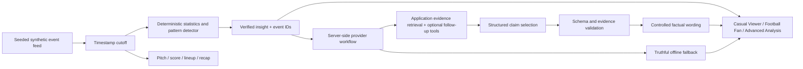

# Between the Lines

**More than the score.** Football insights that go deeper.

Previously called Second Look. The product is now Between the Lines; the repository remains `jbellamy16/second-look`.

Between the Lines is a second-screen football intelligence experience. It turns synthetic match events into a small number of explainable stories, then lets viewers inspect the actions behind each claim. Built for an individual entry in Microsoft’s 2026 Inside the Game Developer Hackathon.

**Released October 11:** [public synthetic demo](https://between-the-lines-jb-f5539b65.azurewebsites.net/) · [deployed commit](https://between-the-lines-jb-f5539b65.azurewebsites.net/release.json) · [submission package](docs/SUBMISSION.md) · [release verification](docs/release-2026-10-11/RELEASE.md). Public AI is disabled and hosted inference quotas are zero.

## The problem

Watching football and understanding how a match is changing are different things. A wall of statistics does little to bridge that gap. Between the Lines connects an observation, its supporting events, a tactical visualization, and a cautious explanation in one interaction.

## What works

- A responsive match centre with original Harbor Athletic and Riverside FC identities, alongside the original Between the Lines identity. No club crests, player photos, or broadcast footage.
- Three deterministic seeded fixtures: increasing pressure, post-substitution changes, and a quiet match.
- Play/pause, restart, seek, five playback speeds, scenario selection, and repeatable demo reset at 63:24.
- An interactive SVG pitch: actual event positions, numbered possession sequences, pass/shot endpoints, and progressive sequence replay. No invented tracking.
- Event-derived score, attempts, shots on target, pass completion, high ball wins, and synthetic chance probabilities.
- Pattern detection for attacking-third ball wins, shot frequency, and passing activity, with equal comparison windows within each half (5–15 minutes each) and supporting event IDs.
- Casual Viewer by default, Football Fan, or Advanced Analysis over the same verified facts, with independent Quick/Full recaps, timestamp-safe Catch Me Up, lineups, and player action maps.
- Guided questions about chance quality, opponent activity and fading increases, with direct deterministic answers, qualifications and replay links.
- Device-local team, player, and insight category preferences that filter and reorder observations.
- Server-side OpenAI (GPT-5.4 Mini) and Microsoft Foundry Responses API adapters with shared forced evidence retrieval, structured selection, validation, and honest provider attribution. **Director 1.4.1 and guided questions are included. The [completed guided study](docs/intelligence/guided-investigations/REPORT.md) produced five verified model answers and one correct no-call for $0.01632525; all answers matched the deterministic baseline. No added investigative benefit was demonstrated. Human review remains pending.**
- Optional AI Catch Me Up, contextual insight narration, and expandable “How Between the Lines knows” evidence.
- Shared Redis quotas, cache, and deduplication; inference remains off by default.
- Explicit offline demonstration mode; request failures or invalid model output fall back to computed explanations without claiming AI generation.

The [first editorial milestone](docs/EDITORIAL-MILESTONE-1.md) aligns the main story, pitch evidence and replay, prioritizes score developments and full time, preserves source timestamp precision, and brings the explanation forward on mobile. Offline Explore evidence opens the checked events without a model request. The [second editorial milestone](docs/EDITORIAL-MILESTONE-2.md) adds synchronized, locally saved explanation styles across the main story, recap and Insights; changing wording preserves the current selection and investigation.

The [Director 1.2 implementation](docs/intelligence/EVOLUTION.md) adds structured hypothesis verification, selective counter-evidence, a typed evidence graph and measured match storylines. The [113-second public synthetic demo](docs/intelligence/DEMO.md) shows joining a match, Catch Me Up, shared facts across styles, evidence replay and a weakening qualification. New model-quality gains are not claimed without a separately authorized live comparison.

## Run locally

Use Node.js **24 LTS** (CI and container target). Next.js 16.4 requires at least Node 20.9; this project supports Node 22–26. Development was also checked on Node 26.

```sh
npm ci
AI_ENABLED=false AI_PROVIDER=offline FOUNDRY_ENABLED=false AI_PROACTIVE_ENABLED=false HISTORICAL_MATCHES_ENABLED=false RECORDED_MATCHES_VISIBLE=false npm run dev
```

Open http://localhost:3000. No account, database, Azure service, or model key is needed for the offline demo. Explicit flags preserve existing local environment files. For a production judge build and exact walkthrough, use [submission setup](docs/SUBMISSION.md#judge-setup-and-walkthrough).

```sh
npm run typecheck
npm test
npm run build
npx playwright install chromium
npm run test:e2e
```

The browser suite runs in desktop Chromium, Chromium with iPhone-sized viewport/touch emulation, and a compact Android-sized Chromium viewport. It audits the five main screens and both dialogs with axe, checks overflow, and exercises touch and keyboard pitch selection. It is not a real Safari-device certification. CI runs the optimized production server. For a production preview locally, run `npm run build && npm start`.

## Architecture



One client playback timestamp is the source of truth. Every derived view uses the event prefix at or before that time. The server independently regenerates the selected fixture and observation; it never trusts client-supplied metrics or evidence. No database or message broker is needed for a deterministic single-match demo.

| Code                                                          | Responsibility                                                                   |
| ------------------------------------------------------------- | -------------------------------------------------------------------------------- |
| `src/lib/match.ts`                                            | Feed model, PRNG, fictional players, event generation, active lineup, statistics |
| `src/lib/intelligence.ts`                                     | Thresholded pattern discovery, evidence windows, mode-specific recap             |
| `src/lib/ai/`                                                 | Provider adapters, verified evidence, story composition, shared usage controls   |
| `src/lib/foundry.ts`                                          | Preserved legacy Foundry workflow and narrative contract compatibility           |
| `src/app/api/insights/route.ts`, `src/app/api/recap/route.ts` | Input validation, server recomputation, narration and fallback                   |
| `src/components/`                                             | Responsive match experience and interactive SVG pitch                            |
| `tests/`, `e2e/`                                              | Data invariants, API contracts, model-tool mocks, browser journeys               |

## Synthetic data and explainability

The seed controls a reproducible event stream. Fictional teams exchange discrete possessions, pass among active teammates, and sometimes create shots, goals, corners, or fouls. Failed passes transfer at the recorded endpoint; fouls return the ball to the fouled team; goals restart at the centre; corners retain the attacking team. Restarts are not counted as high ball wins. Role-aware recipients and short recorded carries connect passes to shot locations. Chance probabilities fall with distance from goal. A substitution replaces an active player at the next possession boundary after 55 minutes. Scenario parameters alter probabilities, **not insight text or detection rules**. The pressure fixture uses seed 202632; the opening demo state has Harbor ahead 1–0 and evidence-supported pressure/chance observations.

Coordinates use 0–100 with each team's attack normalized left to right. The pitch mirrors Riverside when showing both teams. Only recorded events are drawn; lines represent recorded pass/shot endpoints. They do not claim continuous trajectories, ball speed, player speed, or off-ball positions. Possession IDs define sequence boundaries. The synthetic model simplifies stoppages and possession exchanges; it is not calibrated to a professional event-data distribution. Match time is a simplified 90-minute event clock without added time or a halftime break.

`MatchEvent` is the future licensed-feed integration boundary. An adapter would need to normalize coordinates, player/team identity, clock semantics, outcomes, and possession IDs. No real data provider is currently integrated.

Every insight contains category, team, headline, explanation, significance, what to watch, metric, current/baseline counts, both evidence ID sets, and window boundaries. Detectors use descriptive count thresholds, not statistical significance tests. They require enough observations and a meaningful change; no patterns appear before two complete windows of at least five minutes each are available. The quiet fixture has no qualifying observation at the demo timestamp. xG is the generator’s shot probability, not a trained expected-goals model. Passing activity is not mislabeled possession percentage.

## Brand and Phase 2 refinements

The original Between the Lines identity pairs pitch geometry with a single tactical route. Navigation uses outlined SVG lockups and an optically simplified symbol at small sizes. Inter and Barlow Condensed are self-hosted with `next/font/local`. Midnight surfaces, restrained green actions, light/dark appearance, and original broadcast-style social assets are integrated throughout the app. See [brand guidelines](docs/brand/README.md), [asset inventory](docs/brand/asset-inventory.json), and [review evidence](docs/brand/REVIEW.md). Rebuild exports with `npm run brand:build`.

Metadata serves the supplied SVG/ICO favicons, Apple touch icon, Safari mask, 192/512 px icons, maskable icon, 1200×630 Open Graph image, and 1200×675 X image. Set **`NEXT_PUBLIC_SITE_URL` to the public HTTPS origin before a hosted build**. Local builds default to localhost. A manifest supports home-screen identity; no offline service-worker support is claimed. Real external social link previews still need a public deployment.

The evidence inspector offers a readable event summary and a native event picker alongside touch/keyboard pitch markers. Replays follow recorded time gaps at 8× speed and hold the final frame. The selected evidence event determines the replay. On mobile, the insight detail follows the cards before the event feed. The original navigation, modes, stats, lineups, preferences, player maps, and Catch Me Up remain available.

**Watch the build-up** restores the pressure fixture and starts at 60:00 at 16×. High-ball-win evidence qualifies shortly afterward; the default 63:24 view has Harbor ahead 1–0 with four high ball wins and four shots in the recent window, each versus zero in the previous window. **Reset demo** restores that view, all categories, neutral favorites, and 8× playback. Explanation level is a separate saved preference. Switching levels reformats the same verified facts locally, reuses in-flight and cached investigations, and never sends an AI request. Catch Me Up avoids duplicating scoring shots as separate highlights and ends with a full-time message when appropriate.

## Optional AI: OpenAI, Microsoft Foundry, or offline

`AI_PROVIDER=openai|foundry|offline` selects the provider. `AI_ENABLED=true` is a separate spending opt-in. OpenAI defaults to `gpt-5.4-mini` through `/v1/responses`. Foundry retains its Azure Responses endpoint, resource key authentication, endpoint allowlist, deployment name and structured-output workflow. Director investigations receive application-retrieved evidence before the first model request, with optional read-only follow-ups. Managed identity is not implemented. No provider is enabled by default; no resource creation or deployment is part of this change.

The [official model page](https://developers.openai.com/api/docs/models/gpt-5.4-mini) confirms Responses, function calling and structured-output support. Both adapters share the same evidence, output schema, validation, timeout, cache, controls and fallback. Credentials are server-only and ignored in `.env.local`; never prefix them with `NEXT_PUBLIC_`.

With proactive inference disabled, AI runs only after an explicit investigation/review action. Opening Catch Me Up and changing explanation style or Quick/Full do not create model requests. Optional proactive playback investigation requires its own enable flag. Responses belong to an exact timestamp, fixture, evidence set and audience; stale results disappear when context changes.

1. Deterministic detectors find supported changes in equal time windows. Editorial ranking considers magnitude, support, recency, novelty, previously viewed evidence, preferences and audience. This score is not statistical confidence.
2. The Director receives the required broad retrieval before inference. Compact claims keep their exact measurements, limitations, support references and source provenance; optional tools investigate unresolved questions. The legacy insight narrator still retrieves `get_verified_evidence`. Only already-recorded events and verified statements are supplied.
3. The server supplies required match context; the model chooses and orders additional useful statements. Insight context can include contributors, recorded shots after high recoveries, and zero-baseline cautions. Recaps prioritize score, the latest available goal, supported changes and explicit abstention.
4. The server rejects unknown facts, duplicate selections, arbitrary prose, wrong tools, incomplete responses and refusals. It renders every factual sentence from checked data. AI cannot invent statistics or causal claims through this contract.
5. The drawer shows actual provider/model, selected observations, events, comparisons, completed tool activity, validation and limitations. It never exposes private reasoning. Errors show deterministic content without an AI label.

This is **constrained editorial narration**, not unrestricted generated prose. It trades writing freedom for verifiable claims. Whether live AI selects more useful stories than deterministic ranking remains an evaluation question; mock tests do not establish model quality. The original Foundry free-text helper remains for compatibility tests, but public routes use the stronger shared workflow.

### Usage controls

Production requires an existing **TLS Redis** store via `AI_REDIS_URL=rediss://…`. All instances and both providers/routes must share the same store. The app fails closed if it is missing or unavailable. `AI_USAGE_STORE=memory` is permitted only outside production for isolated local testing.

Atomic Redis reservations retain global workflow allowances (defaults **4 per minute / 30 per hour / 60 per day / 100 total**). Individual HTTP attempts also consume hourly, daily and persistent total allowances at those same settings. Shared rolling-minute request/token accounting defaults to hard ceilings of **30 requests / 30,000 estimated tokens**, with at least two seconds between dispatches. These match the owner-authorized Foundry capacity increase verified on October 11, 2026 ([configuration receipt](docs/intelligence/foundry-capacity-2026-10-11.json)). Estimates cover serialized input plus framing and the unchanged **1,800-token output allowance**. Environment settings may lower these ceilings. Hourly/daily/total allowances and existing counters are unchanged; throughput does not grant additional study spending.

Director investigations allow at most **three HTTP attempts including retries**, four evidence queries including application retrieval, and a 55-second workflow deadline. Only an explicit provider 429 can receive one bounded retry per response operation, within the remaining attempt/time/token budget. Retry headers extend a shared cooldown. Network failures, timeouts, 5xx responses, malformed/incomplete output and verification failures are not automatically replayed. Every reservation remains charged, including unknown usage; recovered unknown usage has no invented cost estimate.

Shared locks prevent duplicate inference across instances; local concurrent subscribers share work without sharing cancellation ownership. Other instances receive a temporary fallback while work is pending. Validated results cache for one hour. Failure locks cool down for five seconds (up to the 70-second lease after a process/store failure). Browser caches retain successful reviews, including intentionally offline reviews, but never failure fallbacks. Before reuse, the browser checks an opaque provider/model/implementation fingerprint; exact cutoff, evidence-object revision and preferences remain distinct. See [Foundry efficiency measurements and validation](docs/intelligence/foundry-efficiency-2026-10-11/REPORT.md).

Use Redis persistence and **no-eviction** for quota state. Never flush the store or delete `{second-look-ai}:budget` to recover from an outage; that resets the persistent allowance. Raising the total allowance is an explicit operator spending decision. These are application request limits, not a dollar-denominated billing cap; alerts alone are not spending controls. Shared global limits can be consumed by one visitor, so authenticated per-user allocation or a gateway may be appropriate for a wider launch.

See `.env.example` for all settings. Legacy `FOUNDRY_ENABLED=true` still selects Foundry only when the new provider/enable settings are absent. The legacy hourly limit remains a fallback for `AI_HOURLY_LIMIT`. Production shared-store requirements apply to both. The UI says “configured”, not “live verified”.

### Evaluation

`npm run eval:ai` runs 180 mocked evaluations across three scenarios, three seeds, five timestamps, two audiences and both providers. It writes `artifacts/ai-evaluation.json`. Unit tests add negative claims, fallback, provider contracts, usage controls and caching. CI also runs the atomic scripts against a real Redis service. Read [AI evaluation and human review](docs/AI-EVALUATION.md) before enabling paid inference. `npm run eval:live` is a separate, authorization-gated two-recap check; it is never run by ordinary tests or CI.

## Cloudflare deployment

Cloudflare Workers remains an alternative hosting route alongside the verified Azure deployment. The OpenNext build preserves the app, OpenAI/Foundry adapters and Azure standalone output. It isolates build inputs to exclude local secrets. OpenAI is selected but inference stays disabled with zero quotas until separately approved and shared usage storage is verified in the host runtime. See [Cloudflare deployment](docs/CLOUDFLARE.md) for build, preview, verification and publishing instructions.

## Azure deployment

**Previously deployed:** [Between the Lines on Azure](https://between-the-lines-jb-f5539b65.azurewebsites.net). Read-only checks on October 11 found the homepage accessible and the status API reporting offline. The public response does not expose its commit, and current source parity is unverified. PR #23 was merged on GitHub and local main updated; no deployment followed. See [deployment history](docs/DEPLOYMENT.md) and [current validation](docs/submission-preparation/VALIDATION.md).

Included:

- GitHub Actions checks on PRs and feature/main pushes.
- A manual deployment workflow for an **existing** Azure App Service, with type checks, unit tests, production build, browser tests, and public URL checks.
- A Next.js standalone multi-stage Node 24 Dockerfile, running as a non-root user.

## Hackathon context

Primary target: overall prize. Secondary target: Best Use of Microsoft Foundry. The [official rules](https://github.com/microsoft/insidethegamehackathon/blob/main/OFFICIAL%20RULES.md) were checked October 11, 2026. Their five equally weighted judging criteria map to the synthetic feed and tests, evidence-first tool workflow, second-screen utility, responsive experience, and Microsoft integration. Registration ends October 20 at noon Pacific; submission ends October 27 at 11:59 p.m. Pacific. Video must be less than two minutes; repository must be public; judges need free access through the judging period.

Read [submission preparation](docs/SUBMISSION.md) for the pitch, 114-second demo script and remaining steps. Preparation PR #24 is merged. The authorized [Foundry continuation](docs/intelligence/foundry-bounded-2026-10-11-continuation-1/REPORT.md) executed one provider request and stopped on a local capacity failure: 0 completed, 1 failed, 0 abstained, 5 unattempted; US$0.00179925 conservatively accounted. Director 1.4.1 fixes the reproduced path offline; it has not been live-evaluated. An earlier offline version is hosted; current deployment parity remains unverified. No entry or public AI enablement is claimed.

## Known limits and next work

- Review the captured Foundry Fan/Analyst outputs with a human football reviewer before public AI enablement.
- Test the deployed Azure app on actual mobile Safari; browser accessibility checks passed in Chromium, but physical-device review remains outstanding.
- The feed simplifies football mechanics and only detects three pattern families; validate it with football domain review.
- No audio, multilingual narratives, authentication, or persisted cross-device preferences.
- AI editorial benefit remains unproven; historical Foundry calls do not validate the current Director 1.4.0 workflow or new display styles. Configure an existing shared Redis store before production inference.
- Verified broadcast-story JSON export is implemented; causal substitution effects remain unmeasured.

Original application graphics are SVG/CSS. UI symbols use Lucide (ISC license); third-party library licenses remain applicable. No affiliation with fictional teams is implied, and no official league branding is reproduced.

## Historical match mode (Phase 6)

Synthetic remains the default. **Real Match** offers three licensed Wyscout event
replays from the Premier League 2017–18 season, with spoiler-safe playback,
recorded-action pitch views, evidence-backed observations and Catch Me Up.

- [Data source, license, normalization and limitations](docs/HISTORICAL-DATA.md)
- [OpenAI / Foundry setup, request allowance and evaluation](docs/PHASE-6-AI.md)
- [Third-party attribution](data/historical/LICENSE.md)

No paid AI request is needed for offline replay. Historical inference is optional
and uses the existing server-only, bounded and validated provider adapters.

## Unified football data foundation

All match sources now validate against canonical schema 1.0.0. The synthetic
hackathon scenarios remain the default; Real Match retains three licensed
Wyscout Premier League fixtures. A StatsBomb adapter is available for local
research only, with production access disabled.

- [Canonical model, coordinates and source integration](docs/CANONICAL-FOOTBALL.md)
- [Per-file dataset rights and attribution review](docs/DATA-RIGHTS.md)
- [Synthetic realism benchmark](docs/foundation/BENCHMARK.md)
- [Validation and review evidence](docs/foundation/README.md)
