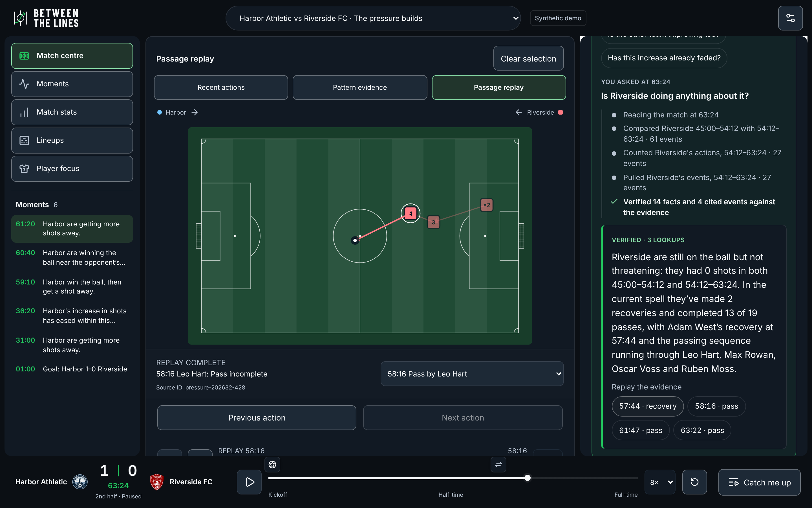
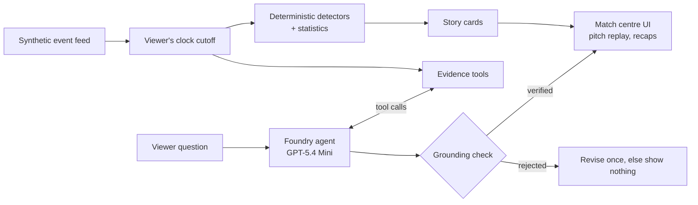

# Between the Lines

**More than the score.** A second-screen match companion that explains what's changing in a football match, shows you the evidence, and answers your questions, with every fact checked.

Built solo for Microsoft's 2026 **Inside the Game** hackathon with the Premier League.

**[Try the live app](https://between-the-lines-jb-f5539b65.azurewebsites.net/)** · Demo video: _link added at submission_ · [Submission summary](docs/SUBMISSION.md)



## The problem

You join a match at 63 minutes. The score says 1–0. It doesn't say that one team has taken four shots in nine minutes after none before, or whether that surge is already fading. Stats panels give you numbers without the story. Commentary gives you a story you can't check. Between the Lines does both: it tells you what changed and shows you exactly which moments prove it.

## What it does

- **Tells the story as it develops.** Deterministic detectors compare equal windows of play and surface the few changes that matter: a shot surge, a spell of ball wins high up the pitch, a substitute's involvement. Each comes as a headline, why it matters, supporting and challenging evidence, and what to watch next.
- **Answers your questions with a Foundry agent.** Type anything: "Is Riverside doing anything about it?" An agent on Microsoft Foundry picks evidence tools, reads the results and answers in a sentence or two. You watch each step as it happens. A grounding check confirms every number, time and name before the answer appears. If the events can't answer your question, it says so. [How the analyst works](docs/ANALYST.md)
- **Shows where it happened.** An interactive pitch plots the recorded actions behind every claim and replays the build-up to any shot.
- **Pitched at your level.** Choose Casual Viewer, Football Fan or Advanced Analysis. The same verified facts are rewritten for each level, and the agent's answers follow suit. Follow a team or player to reorder the stories.
- **Catches you up.** Quick or Full recaps for the moment you join, with no spoilers past your position in the match.

## Plug it into any agent

The analyst's evidence tools are also a read-only [MCP](https://modelcontextprotocol.io) server at `/api/mcp` (Streamable HTTP, no login). A broadcaster's own assistant, a production team's Copilot or a club's data desk can connect and work the match without rebuilding any of it. The connection pins a match time (`?t=77:00`, or full time if omitted). Every tool is bounded by that time, so an agent can't see or spoil anything later; out-of-range queries are refused with the same reasons the analyst gets. Results are deterministic, with no model calls and no spend on our side, and each client is rate limited.

```text
https://between-the-lines-jb-f5539b65.azurewebsites.net/api/mcp?t=77:00
```

In VS Code, add it as an HTTP server (**MCP: Add Server**), then ask Copilot in agent mode: "Catch me up on this match."

## How it fits the challenge

| Challenge stage | In Between the Lines                                                                                      |
| --------------- | --------------------------------------------------------------------------------------------------------- |
| Ingest          | A seeded, football-realistic synthetic event feed (passes, carries, shots, xG, recoveries, substitutions) |
| Interpret       | Cutoff-safe statistics and equal-window pattern detection with supporting event IDs                       |
| Explain         | Story cards plus the Foundry analyst agent, with every claim grounded in recorded events                  |
| Render          | Responsive match centre, SVG pitch with sequence replay, recaps, lineups and player maps                  |
| Personalize     | Three explanation levels, favorite team and player, category filters                                      |

## Architecture



One playback timestamp is the source of truth. Every view, tool and answer uses only events at or before it. The server rebuilds the match itself and never trusts statistics or evidence sent by the browser.

**Microsoft and Azure:** Microsoft Foundry (GPT-5.4 Mini deployment, Responses API with function calling) runs the analyst agent. Azure App Service hosts the Next.js app and the MCP endpoint. GitHub Actions runs type checks, 730+ unit tests and a Playwright suite across desktop and two mobile viewports on every push.

**Evaluated:** the last five runs of the 18-question analyst eval against the Foundry deployment (12 match questions, 6 it should decline) each scored 18/18. Answers take about 4 seconds and cost about $0.006. [Evidence](docs/SUBMISSION.md#evidence)

**Spend controls:** every model call reserves its worst-case cost against a shared dollar ledger before dispatch. Request caps apply per minute, hour and day, plus a per-client limit. If any limit is hit, the app falls back to the deterministic story. [Details](docs/ANALYST.md#spending-controls)

## Run it locally

Node.js 22–26 (24 LTS recommended). No account or key is needed for the offline experience:

```sh
npm ci
AI_ENABLED=false npm run dev
```

Open http://localhost:3000. To try the live analyst, add Foundry settings to `.env.local` as shown in [docs/ANALYST.md](docs/ANALYST.md#test-it-live).

```sh
npm run typecheck && npm test && npm run build   # checks
npx playwright install chromium && npm run test:e2e
npm run eval:analyst                             # live agent eval (spends a few cents)
```

Releases go to Azure App Service with `bash scripts/release.sh`, which builds the pushed `main` in a clean clone, tests it, packages it and verifies the live app ([deployment](docs/DEPLOYMENT.md)).

## Code map

| Path                   | What's there                                                         |
| ---------------------- | -------------------------------------------------------------------- |
| `src/lib/match.ts`     | Seeded synthetic match generator, fictional teams and players        |
| `src/lib/sources/`     | Canonical event model, adapters and cutoff-safe views                |
| `src/lib/ai/director/` | Story detection, evidence tools, hypothesis checks, guided questions |
| `src/lib/ai/analyst/`  | Ask the Analyst agent loop, grounding check, types                   |
| `src/lib/ai/`          | Provider adapters, spend ledger, shared usage controls               |
| `src/app/api/`         | `ask` (streaming agent), `mcp` (MCP server), `director`, `recap`     |
| `src/components/`      | Match centre, pitch, story card, analyst panel, recaps               |
| `tests/`, `e2e/`       | Unit tests and Playwright journeys with axe accessibility checks     |

## Synthetic data

The hackathon requires synthetic, football-realistic data. A seed controls a reproducible stream of possessions between two fictional clubs, Harbor Athletic and Riverside FC. It includes role-aware passing, carries, shots with distance-based chance probabilities, recoveries, fouls, corners, goals and a substitution. Three scenarios cover rising pressure, post-substitution change and a quiet match. Scenario settings change probabilities, never insight text or detection rules. Coordinates are 0–100 with each team attacking left to right. Only recorded events are drawn; there is no invented tracking data.

## Limits

- The event model is simplified: no added time or half-time break, and only recorded on-ball actions. It has not been calibrated against professional event data.
- "xG" is the generator's shot probability, not a trained expected-goals model.
- Detectors use descriptive count thresholds, not statistical significance tests.
- The analyst's grounding check catches invented numbers, times and names, plus obvious speculation. It checks each fact, not how facts relate, and it cannot judge whether an answer is the most useful one; that has not been measured with viewers.
- No accounts, cross-device preferences, audio or multilingual output.

Club names, players and the Between the Lines identity are original to this project. There is no affiliation with real clubs or leagues and no league branding. Fonts and icon libraries keep their own licenses ([brand notes](docs/brand/README.md)).
