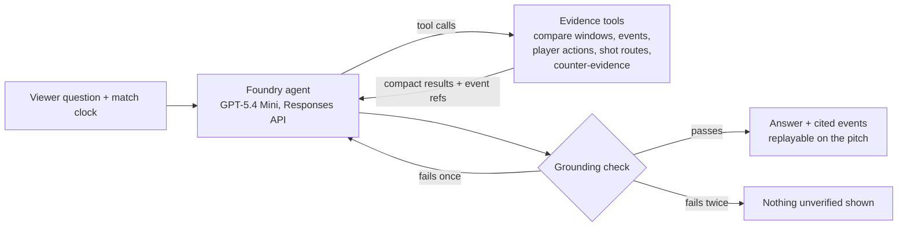

# Ask the Analyst

Ask the Analyst lets a viewer type any question about the match so far. A Microsoft Foundry agent picks which evidence tools to call, reads what they return, and writes a short answer. Before the viewer sees it, a deterministic check confirms that every number, match time and player name in the answer came from that evidence. If the check fails, the agent gets one chance to revise. If it fails again, nothing is shown.

## How it works



- **Tools.** The same nine read-only functions the Director uses (`src/lib/ai/director/tools.ts`), with a compact view for the agent (`src/lib/ai/analyst/toolset.ts`): per-team counts, who received each pass, a ranking when no player is named, and comparison windows fitted inside the half. They only see events at or before the viewer's clock, so the agent can't spoil the match.
- **Agent loop.** `src/lib/ai/analyst/agent.ts`. At most 4 model requests and 5 tool calls per question, with parallel tool calls and a 45-second deadline. Invalid tool queries go back to the agent as errors it can correct.
- **Grounding check.** `src/lib/ai/analyst/grounding.ts`. It compares every clock time, number and player name in the answer against what the tools returned. Counts are tied to what was counted: "4 shots" must match a shot count, not just any 4, and a count written next to a window the tools reported ("3 shots in 60:00–70:00, up from 2 in 50:00–60:00") must be that window's count. A player's first name must match the surname it goes with. A time the viewer asks about that hasn't been played yet may only appear in a decline. It also rejects predictions, claims about feelings or intent, question marks in an answer, and internal event references (such as "e4") left in the text instead of a time and player. It is pure code with no model involved. It checks each fact, not how facts relate: it can't tell that a shot listed at 59:09 is outside a window described as 60:00–70:00.
- **Streaming.** `POST /api/ask` streams NDJSON. Each step (tool call, verification, revision) appears in the UI as it happens, then the result arrives.
- **Personalization.** The viewer's explanation level (Casual Viewer, Football Fan, Advanced Analysis) sets the agent's tone. The facts and checks stay the same.
- **Caching.** Identical questions at the same clock reuse the verified answer for an hour at no cost.

## Spending controls

Every provider call in the app goes through one dollar ledger (`src/lib/ai/spend-ledger.ts`):

- Before each attempt, the app reserves the worst case for that attempt: one token per byte of the request, plus the full 1,800-token output allowance, at retail rates. Real usage is normally a quarter of that or less.
- Reservations are never refunded. When the next reservation would cross `AI_SPEND_CEILING_USD`, the app stops calling the model and shows the deterministic story instead.
- `AI_SPEND_LEDGER` names the ledger, so local testing (`test`) and the public app (`production`) never share an allowance.
- Production refuses to call a model if no ceiling is set.
- The existing per-minute, hourly, daily and total request caps and the per-client limit (`AI_ASK_PER_CLIENT_LIMIT` questions per 10 minutes, 12 by default and 30 on the live app) still apply on top. A client is the address App Service appends to `X-Forwarded-For`, so a caller can't reset its limit by sending its own.

Across three runs of the 18-question eval, a question took 1–2 model requests and cost about $0.006 at retail rates (at most $0.01). The ledger reserves several times that per attempt, so a $15 ledger stops well before $15 of real spend.

`npm run ai:spend` prints how much each ledger has reserved.

## Test it live

Add the Foundry settings to `.env.local` (git ignores it):

```sh
FOUNDRY_ENDPOINT=https://<resource>.openai.azure.com
FOUNDRY_API_KEY=<key>
FOUNDRY_DEPLOYMENT=between-the-lines-gpt54-mini
```

Then run the eval from your own terminal:

```sh
npm run eval:analyst              # 12 golden + 6 adversarial questions, about $0.11
npm run eval:analyst -- golden    # just the golden set
```

For its own run, the eval switches on Foundry, raises the local request caps and uses a $15 in-process test ledger, whatever `.env.local` says. Values set in the shell still win.

To try it in the browser, run the dev server with the analyst on:

```sh
AI_ENABLED=true AI_PROVIDER=foundry AI_USAGE_STORE=memory AI_REDIS_URL= \
AI_MINUTE_LIMIT=10 AI_HOURLY_LIMIT=100 AI_DAILY_LIMIT=500 AI_TOTAL_LIMIT=5000 \
AI_SPEND_LEDGER=test AI_SPEND_CEILING_USD=15 npm run dev
```

The eval prints each answer, its steps and its estimated cost, and saves everything to `artifacts/analyst-eval/`, including why any tool query was refused. A golden question passes when it gets a verified answer. An adversarial question passes when the agent declines or redirects without making something up. The score checks status, not accuracy, so the eval also lists answers to review by hand (a question mark or a self-correction); read the answers, not just the score.

## Turn it on in Azure

Add these App Service settings on the existing web app. `FOUNDRY_*` and `AI_PROVIDER=foundry` are already there.

| Setting                                 | Value                                                                         |
| --------------------------------------- | ----------------------------------------------------------------------------- |
| `AI_ENABLED`                            | `true`                                                                        |
| `AI_REDIS_URL`                          | `rediss://…` (Upstash free tier is enough; TLS required)                      |
| `AI_SPEND_LEDGER`                       | `production`                                                                  |
| `AI_SPEND_CEILING_USD`                  | `15`                                                                          |
| `AI_MINUTE_LIMIT`                       | `10`                                                                          |
| `AI_HOURLY_LIMIT`                       | `300` (the code allows up to 1000)                                            |
| `AI_DAILY_LIMIT`                        | `500`                                                                         |
| `AI_TOTAL_LIMIT`                        | `5000`                                                                        |
| `AI_ASK_PER_CLIENT_LIMIT`               | `30` questions per client per 10 minutes                                      |
| `AI_TOKEN_MINUTE_LIMIT`                 | Match the deployment's tokens-per-minute limit (see below)                    |
| `AI_REQUEST_MINUTE_LIMIT`               | Match the deployment's requests-per-minute limit                              |
| `AI_PROACTIVE_ENABLED`                  | `false`                                                                       |
| `AI_INVESTIGATOR_ENABLED`               | `false`. If this is `true`, it forces every other AI path offline             |
| `APPLICATIONINSIGHTS_CONNECTION_STRING` | From the Application Insights resource. Leave it unset to turn telemetry off. |

**Raise the deployment's rate limit.** At 30k tokens per minute the app can answer only about one question a minute in total, because each question uses roughly 15–30k estimated tokens. Pay-as-you-go deployments bill per token, not per unit of capacity, so a higher limit costs nothing by itself. In the Foundry portal, edit the deployment's tokens-per-minute limit to 150k (if your quota allows), then set `AI_TOKEN_MINUTE_LIMIT=150000` and `AI_REQUEST_MINUTE_LIMIT=150`. The code allows up to 300k and 300. The dollar ledger, not throughput, is what stops spending. Also set an Azure budget alert; it only sends email, but it's a useful second signal.

Verify after deploy: `GET /api/ask` returns `{"enabled": true}`. Then ask one question signed out on desktop and on a phone.
