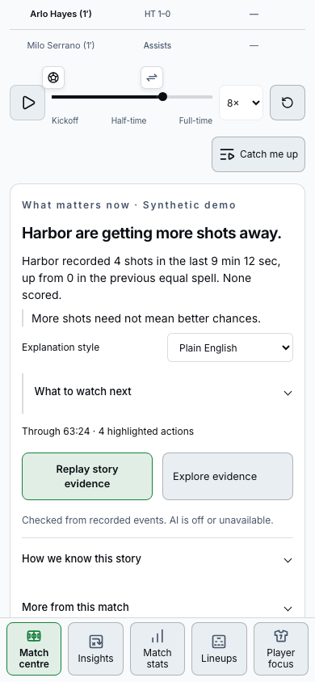
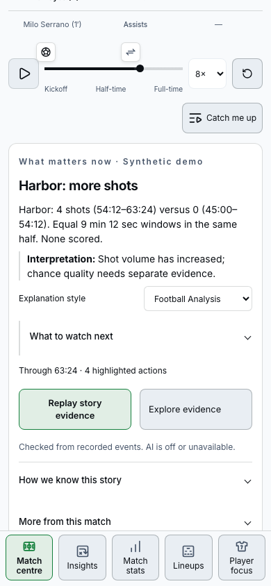

# Plain English and Football Analysis

Implemented against `main` at `9a5b9b3` on October 11, 2026, after reviewing PRs #21 and #22. No open PRs were present at the start. The existing development checkout and its running server were preserved; implementation and AI-disabled validation use an isolated `codex/plain-english-football-analysis` worktree.

## Viewer behavior

Plain English is the default. A compact native selector beneath the main explanation, the same preference in Settings, and selectors in Catch Me Up and Insights all share one locally persisted value. Changing it updates the current explanation immediately. No onboarding or new global analytics mode is introduced.

Plain English leads with the development and uses everyday language. Football Analysis names the measurement, gives both comparison periods, and separates observation from interpretation. Both use controlled wording over the same verified events, measurements and qualifications. Quick and Full still control recap length, independently of explanation style.

The shared presentation layer renders the main story, broadcast preview, recap, and Insights. Existing investigation-selected supporting facts remain selected when wording changes. The presentation preference never enters `StoryPreferences`, the legacy `fan`/`analyst` investigation mode, a request body, or a cache key. It does not reset the selected observation, cutoff, event picker, replay or favorites. Storage failure leaves the preference usable and synchronized for the current page; persistence requires available browser storage.

Explore evidence remains available in both styles and both recap lengths, including quiet spells. It exposes source events, definitions, comparison windows, counter-evidence and source limits; event timestamps link to their recorded passages. Score and full-time priority, quiet-spell restraint, the same-half equal windows, and the broader ball-win definition remain unchanged. Fixed five-minute recovery history remains explicitly distinct from the ball-win comparison.

## Actual app examples

These excerpts are rendered from the bundled application data, not a live model response. The full wording and qualifications, source identity, cutoff, statistics, windows and event IDs are saved in [examples.json](explanation-styles/examples.json). Harbor–Riverside is **synthetic**; Arsenal–Leicester is **recorded**.

| Situation                         | Plain English                                                                                                                                                                            | Football Analysis                                                                                                                                                                                  |
| --------------------------------- | ---------------------------------------------------------------------------------------------------------------------------------------------------------------------------------------- | -------------------------------------------------------------------------------------------------------------------------------------------------------------------------------------------------- |
| Four shots at 63:24               | Harbor recorded 4 shots in the last 9 min 12 sec, up from 0 in the previous equal spell. None scored. More shots need not mean better chances.                                           | Harbor: 4 shots (54:12–63:24) versus 0 (45:00–54:12). Equal 9 min 12 sec windows in the same half. None scored. Interpretation: Shot volume has increased; chance quality needs separate evidence. |
| Four ball wins near goal at 63:24 | Harbor recorded 4 ball wins near the opponent’s goal in the last 9 min 12 sec, up from 0 in the previous equal spell. They do not guarantee a shot or tell us how hard the team pressed. | Harbor: 4 ball wins in the attacking third (54:12–63:24) versus 0 (45:00–54:12). Equal 9 min 12 sec windows in the same half. They do not establish pressing intensity.                            |
| Weakening at 70:00                | The increase has eased: 1 shot in the later half of this spell, after 3 in the first half.                                                                                               | The rate declined within the current window: 1 shot in its second half versus 3 in its first. The increase may be fading.                                                                          |
| Recent goal at 01:00              | Arlo Hayes scored at 01:00. Harbor 1–0 Riverside. The goal changes the score. Watch how the next passage develops.                                                                       | Arlo Hayes scored at 01:00. Harbor 1–0 Riverside. Scoring events through this cutoff determine the score; penalty shootouts are excluded.                                                          |
| Full time                         | Full time: Arsenal 4–3 Leicester City. O. Giroud scored at 84:34. The result is settled.                                                                                                 | Same result and goal time; the explanation adds that scoring events through the cutoff determine the score and penalty shootouts are excluded.                                                     |
| Approximate substitution          | D. Gray has 3 recorded actions with the ball, including 0 shots, since coming on at ~88′. A ~ before a time means the source gives only an approximate minute.                           | D. Gray has 3 recorded on-ball actions, including 0 shots, since coming on at ~88′. Times marked ~ have source minute precision; exact seconds are unavailable.                                    |

The quiet fixture continues to say **No new headline**. It offers local recorded-event exploration in either style, without promoting routine passes into a lead.

The lower-total-xG case uses a clearly marked **diagnostic unit fixture** with complete source ratings. Both styles retain the same current/previous totals and the qualification that more shots have not improved aggregate chance quality. Plain English explains expected goals as an estimate of how likely shots are to score. Missing and incomplete xG are tested separately; neither is turned into a fabricated quality comparison. This fixture is correctness evidence, not a claim about the bundled real matches.

## Verification and implementation limits

The client only presents facts already checked by the existing independent verification path. No model-authored prose is added. PR #22's request accounting, reservations, pacing, cancellation, failed-result recovery and provider configuration fingerprint are unchanged. Successful investigations remain reusable after a style change; browser fixtures exercise both in-flight and settled results without paid inference.

The recap validation now compares the hypothesis timestamp with the selected story's event timestamp, while separately enforcing the exact requested cutoff and all event/window bounds. Previously, demanding that the latest event time equal the cutoff silently discarded valid investigation selections. Tests cover a query-selected sample, a player-specific earlier sample at full time, and future-event rejection. Recap goal prose also uses the existing source-aware event clock.

Dense passing comparisons in Insights retain their existing event set even when it exceeds the Director's 120-event publication cap. Their original detector rechecks the complete comparison before the shared wording is applied. The Arsenal sample at 30:00 remains 153 passes versus 83, with the decrease from 86 to 67 within the current window visible in both styles. Director eligibility and its verification limits are unchanged.

- `AI_ENABLED=false npm run check`: type generation, TypeScript, **463 unit tests passed**, production build passed. Three conditional unit cases skipped locally: two external Redis tests and one optional StatsBomb fixture. CI supplies Redis.
- Production browser suite with recorded fixtures visible: **216 passed**, no retries, across desktop and both phone projects. Cross-source layout checks measure spacing below the actual story on mobile, allowing truthful explanations to differ in height.
- Cloudflare build and `wrangler deploy --dry-run`: passed. Cloudflare browser preview: **171 passed, 45 skipped** because recorded fixtures are disabled in that build. No retries.
- New coverage: 10 unit cases and 7 browser scenarios across three projects, including persistence, storage failure, cross-tab sync, keyboard use, all four recap combinations, in-flight and cached investigations, selected evidence/replay/favorites, qualifiers, source precision and rewind. Axe checks and overflow checks cover both styles at desktop, tablet and phone sizes.

Automated checks establish specific correctness properties; they do not show that viewers prefer either wording. No viewer study, physical-device Safari test or live editorial comparison has been performed. Native screen-reader behavior still needs device-level review. The downloadable verified-story JSON retains its existing evidence schema and investigation audience; display wording is rendered locally. No paid/live model calls, AI enablement, Azure changes, deployment or merge were performed. Historical evaluation receipts are unchanged.

## Screenshots

Inspected at 1440px desktop, 834px tablet, and 390px/360px phone widths. Phone comparison images are scrolled to the story so the controls and qualifications are visible; the [full page](explanation-styles/screenshots/mobile-full-page.png) records its placement. These are Chromium layouts, not physical-device or Safari validation.

| View          | Plain English                                                                            | Football Analysis                                                                               |
| ------------- | ---------------------------------------------------------------------------------------- | ----------------------------------------------------------------------------------------------- |
| Desktop       | [Full view](explanation-styles/screenshots/desktop-plain.png)                            | [Full view](explanation-styles/screenshots/desktop-analysis.png)                                |
| Tablet        | [Full view](explanation-styles/screenshots/tablet-plain.png)                             | [Full view](explanation-styles/screenshots/tablet-analysis.png)                                 |
| Phone · 390px |  |  |
| Phone · 360px | [Story view](explanation-styles/screenshots/mobile-360-plain.png)                        | [Story view](explanation-styles/screenshots/mobile-360-analysis.png)                            |

[Synchronized preference in Settings](explanation-styles/screenshots/settings.png).

## Viewer-review checklist

- After the Plain English story, can a casual viewer explain what changed and why it matters without opening the evidence?
- Can they distinguish more shots from better chances, and explain what expected goals means when it appears?
- Does Football Analysis provide useful measurement and comparison detail without suggesting causation, pressing intensity or player intentions?
- In a weakening spell, do both audiences notice the qualification before drawing a stronger conclusion?
- Can a viewer switch styles and Quick/Full without feeling that the selected story, replay or score changed?
- Can they find Explore evidence, understand the two comparison periods and replay the relevant action? Do they recognize `~88′` as approximate?

No reviewers were contacted. These questions are for subsequent human review; no human validation is claimed.
