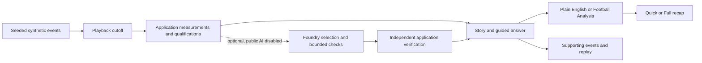

# Between the Lines — submission package

Prepared October 11, 2026 (America/Chicago). Product PR [#26](https://github.com/jbellamy16/second-look/pull/26) is merged. The [public Azure release](https://between-the-lines-jb-f5539b65.azurewebsites.net/) serves **2014a497c84c799952c218a0229ec0c16bd964b1**, identified by [/release.json](https://between-the-lines-jb-f5539b65.azurewebsites.net/release.json). Public AI is disabled; only synthetic matches are accessible. See [release verification](release-2026-10-11/RELEASE.md), [viewer test](release-2026-10-11/VIEWER-TEST.md), and [113-second demo](intelligence/DEMO.md). Registration and authenticated portal fields remain unverified. Human validation, video publication and entry submission remain pending.

## Pitch

**More than the score.** Joining a football match late should not mean deciphering a wall of statistics. Between the Lines connects the score to what changed, offers a Quick or Full Catch Me Up, and lets viewers ask focused football questions. Plain English and Football Analysis explain the same checked facts. Every answer carries its qualifications and supporting events, which viewers can inspect and replay. The public Azure demo uses fictional teams and deterministic synthetic events. Optional Microsoft Foundry investigations select from independently verified evidence; application code controls calculations and factual wording.

## Product description

At 63:24 Harbor lead 1–0 and have taken four shots after none in the previous equal period. The app distinguishes more attempts from better chances. At 70:00 a guided question asks whether the increase has faded: the wider count rose from one to four, but the latest window's halves fell from three to one. The answer preserves both facts and explains their limits. Selecting a supporting event replays its schematic passage without moving the main match clock. Rewinding removes later information.

The proposed benefit is faster, more accurate understanding for casual and knowledgeable viewers. That benefit still requires actual participant responses; automated checks do not establish usefulness.

## Links for the entry

| Field               | Final value                                                                                                                        |
| ------------------- | ---------------------------------------------------------------------------------------------------------------------------------- |
| Project             | Between the Lines                                                                                                                  |
| Tagline             | More than the score.                                                                                                               |
| Working application | https://between-the-lines-jb-f5539b65.azurewebsites.net/                                                                           |
| Public repository   | https://github.com/jbellamy16/second-look                                                                                          |
| Product commit      | https://github.com/jbellamy16/second-look/commit/2014a497c84c799952c218a0229ec0c16bd964b1                                          |
| Judge instructions  | This document, below                                                                                                               |
| Video               | Local `artifacts/final-release-2026-10-11/demo/between-the-lines-demo.mp4`; public URL pending owner publication                   |
| Suggested entry     | Individual, subject to eligibility/registration confirmation                                                                       |
| Category choice     | Overall; consider Best Use of Microsoft Foundry only with the limitations below. Owner confirms the portal's available categories. |

## Microsoft technology and architecture

| Component                                  | Implemented responsibility                                                                                                                    | Demonstrated limit                                                                                             |
| ------------------------------------------ | --------------------------------------------------------------------------------------------------------------------------------------------- | -------------------------------------------------------------------------------------------------------------- |
| Azure App Service                          | Public Next.js standalone server on Linux Node 24, existing Free F1 plan; signed-in Azure CLI deployment.                                     | Free-tier capacity and availability limits; no uptime SLA or enterprise-readiness claim.                       |
| Microsoft Foundry / Azure OpenAI Responses | Optional server-side structured claim selection and bounded follow-up evidence queries using the existing GPT-5.4 Mini deployment.            | Disabled publicly. Guided study confirmed baseline answers; it did not show added investigative benefit.       |
| Application TypeScript                     | Seeded events, cutoff-safe score/metrics, equal-window comparisons, typed questions, independent verification and controlled factual wording. | Synthetic event-model xG and schematic positions are not professional tracking or calibrated live predictions. |
| React / Next.js / SVG                      | Shared story, pitch evidence, replay, independent style/recap length, local favorites and navigation.                                         | Chromium desktop/touch-size tests; physical Safari and screen-reader testing remain unperformed.               |
| GitHub                                     | Public source, pull requests, automated checks and release evidence.                                                                          | Merging alone does not deploy the Azure application.                                                           |



This is one bounded investigator with application tools. There is no implemented Foundry Agent Service, Agent Framework, MCP orchestration, Fabric, managed identity or multi-agent system. Foundry does not write unchecked factual prose or verify its own claims. No model request is needed for public style changes, questions, evidence or replay.

## Demonstrated results and limitations

The [guided campaign](intelligence/guided-investigations/REPORT.md) produced **five verified model answers and one correct no-call**, using **five HTTP attempts** and **US$0.01632525** in conservative token-rate accounting. All five model answers matched the same-question deterministic baseline; no additional follow-up evidence was selected. **Additional investigative benefit was not demonstrated.** These are assistant-analyzed synthetic/diagnostic cases, not participant feedback or broad real-match reliability.

The paid-evaluated commit was `b56090090cf85c43a28ca07755764082d7bcaec3`. The later UI cancellation fix in `1ac8706` passed offline browser validation; the current release includes that fix. No campaign was rerun, no counters were reset, and historical receipts remain intact. Earlier failed studies remain documented in their original reports.

The public walkthrough verifies initial score/clock/story, all four style/length combinations, questions and qualifications, evidence/replay, favorites/navigation, cancellation and stale responses, rewind, accessibility checks and synthetic source restrictions. Browser interception is used only in labeled cancellation/recovery tests, never in the demo footage or unmocked walkthrough. See [evidence and limitations](release-2026-10-11/RELEASE.md).

## Judge setup and walkthrough

Open the [public application](https://between-the-lines-jb-f5539b65.azurewebsites.net/) in a private browser window. No login, payment, key or setup is required. For an existing session: Settings → Generator profile **Curated demo** → Reset demo; select **Plain English** afterward. Choose **The pressure builds**, seed **202632**, paused.

1. At **63:24**, confirm Harbor **1–0** Riverside. Read the story: Harbor shots **0 → 4**, equal **9m12s** windows, none scored. The quality question is unavailable because the earlier window has no shots.
2. Open **Catch me up**. Switch Quick / Full and Plain English / Football Analysis independently. Facts and the cutoff stay consistent; only presentation changes.
3. Return to Match centre, ask **Is the other team improving too?**, and inspect its direct answer and shared-window evidence. It compares recorded activity, not overall match control.
4. Seek to **70:00** while paused. Drag the Match timeline near the target, then use arrow keys for one-second precision; confirm the visible clock. Ask **Has this increase already faded?** The answer is yes: wider windows **1 → 4**, recent halves **3 → 1**. The slowdown does not erase the wider increase or predict the next goal.
5. Open **Explore answer evidence**, choose **59:09 · shot · Replay**. Six actions run from **58:39 to 59:09** at 8×; the main clock stays **70:00**. Positions are schematic, not tracking or match footage.
6. Rewind the Match timeline to kickoff (Home key). Score becomes **0–0**, the later question disappears, and Catch Me Up has no later goal or story.

For a local fallback, use Node 24 and a fresh checkout of the product commit:

```sh
npm ci
AI_ENABLED=false AI_PROVIDER=offline FOUNDRY_ENABLED=false AI_PROACTIVE_ENABLED=false HISTORICAL_MATCHES_ENABLED=false RECORDED_MATCHES_VISIBLE=false npm run build
AI_ENABLED=false AI_PROVIDER=offline FOUNDRY_ENABLED=false AI_PROACTIVE_ENABLED=false AI_MINUTE_LIMIT=0 AI_HOURLY_LIMIT=0 AI_DAILY_LIMIT=0 AI_TOTAL_LIMIT=0 HISTORICAL_MATCHES_ENABLED=false RECORDED_MATCHES_VISIBLE=false PORT=3124 HOSTNAME=127.0.0.1 npm start
```

Open http://127.0.0.1:3124. Process flags preserve existing local environment files. This runs the same deterministic experience without Azure or model access.

## Source attribution

The demo's fictional Harbor Athletic, Riverside FC, players, seeded events, pitch graphics and Between the Lines identity are project assets. Replays are generated event visualization, not broadcast footage. No real-match data is accessible in the submission configuration. Historical Wyscout notices remain in the repository; StatsBomb research data is neither redistributed nor exposed. See [data rights](DATA-RIGHTS.md).

Inter and Barlow Condensed use the retained [font licenses](brand/README.md). Lucide notices are distributed in `public/icon-licenses.txt`; dependency licenses remain applicable. The video uses neutral macOS Samantha synthetic narration, no music, and actual application footage. Ownership and entry warranties require the owner's confirmation; public repository access is not itself a license grant.

## Official rules and portal status

Verified October 11 from the [official rules](https://github.com/microsoft/insidethegamehackathon/blob/main/OFFICIAL%20RULES.md). Registration ends **October 20, noon Pacific / 2 p.m. Chicago**; submissions end **October 27, 11:59 p.m. Pacific / October 28, 1:59 a.m. Chicago**. Keep the application available free and unrestricted through **November 10, 11:59 p.m. Pacific / November 11, 1:59 a.m. Chicago**.

Required materials include an English pitch, public GitHub repository, functioning project access, and a public demonstration video **under two minutes** showing the software working. Use authorized synthetic data/assets. Owner must confirm eligibility, creation after registration opened September 29, ownership, and category fit. The five judging criteria are equally weighted: implementation, agentic design/innovation, impact, experience/presentation, and category adherence.

The [official entry link](https://aka.ms/insidethegame) redirects to [Innovation Studio](https://innovationstudio.microsoft.com/hackathons/insidethegamedeveloperhackathon). Fresh signed-out inspection on October 11 reached Microsoft sign-in. Registration, exact Projects fields, field limits and additional authenticated requirements remain **unverified**. No terms were accepted and no form was submitted.

## Owner actions remaining

- Confirm eligibility/registration and inspect authenticated Projects fields before the dates above; retain proof of registration.
- Return actual casual and knowledgeable viewer responses using the [compact protocol/template](release-2026-10-11/VIEWER-TEST.md). Human validation remains pending.
- Review the local 113-second export, publish it on an allowed host such as YouTube or Vimeo when ready, and paste the resulting public URL into the entry. Upload SRT captions; check signed-out playback and duration after processing. No video has been published.
- Confirm rights, category and final entry fields, then submit personally or explicitly authorize submission. No submission has occurred.
- Keep the existing free public app accessible through judging. Free-tier quota exhaustion or service outages require attention; do not upgrade or enable paid inference automatically.
