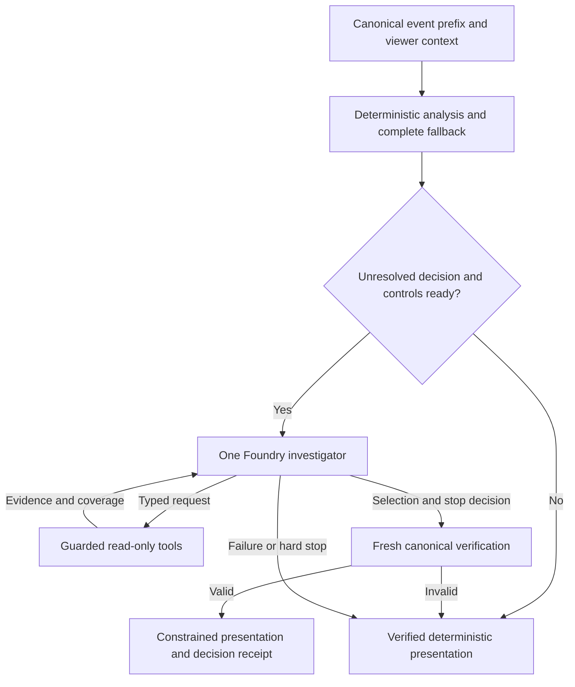

# Proposal: a bounded football investigator

October 12, 2026. **Design only. No architecture, tool, prompt, fixture, inference setting or deployment is changed. No paid AI calls are authorized or made.**

## Recommendation

Evolve the existing Match Director into **one Foundry-powered investigator that chooses what is worth investigating, which evidence could change the answer, and when to stop**. Keep measurements, descriptive eligibility rules, independent verification, evidence contracts, rendering and spending controls in application code. The proposed model contribution is better decisions under a viewer's limited attention, not arithmetic or authority over facts.

Start with an existing development: “What should this viewer notice now, and what most strongly qualifies that reading?” The investigator chooses among supported competing descriptions, follows a useful evidence branch, and prioritizes material changes. A hypothesis is a descriptive possibility, never a causal explanation. Mixed and unresolved outcomes are legitimate.

This is falsifiable: if the strongest deterministic policy makes equally useful decisions, retain it. No current result establishes that Foundry will outperform it. This proposal incorporates the negative attribution result following the earlier [shot-surge proposal](COMPETING-EXPLANATIONS-PROPOSAL.md); it does not rename that implementation's deterministic gains as agentic discovery.

## Evidence and current architecture

Reviewed source: synchronized main `dae1815cd58097f31c47d1de50ed82d4b171b204`, after merging [PR #36](https://github.com/jbellamy16/second-look/pull/36). Its exact reviewed head was `cec66f97e02659b047c8b1c906064a3be86d3d74`; four CI checks passed, no unresolved review threads remained, and 118 focused tests passed locally before the guarded squash merge. The pre-existing generated `next-env.d.ts` change is excluded here.

| Evidence                                                                                                                                                                                                                             | Consequence                                                                                                                                                               |
| ------------------------------------------------------------------------------------------------------------------------------------------------------------------------------------------------------------------------------------ | ------------------------------------------------------------------------------------------------------------------------------------------------------------------------- |
| [Offline comparison](DIRECTOR-OFFLINE-EVALUATION.md): 14 authored states in seven correlated families. A supplies 7 useful fact–case pairs; strengthened deterministic B supplies **all 35**; fixed/adaptive scripts also supply 35. | All 28 extra pairs over A belong to code. There is no factual-discovery headroom under that frozen rubric. Retain it as a regression suite, not a new positive benchmark. |
| Adaptive script: 11/11 relevant queries versus fixed 11/16; 19 HTTP dispatches versus 22; 8/8 versus 6/8 scripted completions.                                                                                                       | A hand-written branching policy already captures this efficiency. It is a baseline to beat, not model intelligence. Mock timings/token estimates are not live results.    |
| [Guided Foundry study](guided-investigations/REPORT.md): five model answers matched deterministic answers, one appropriate no-call, zero optional follow-ups.                                                                        | Verification and correct answers alone do not establish investigative benefit.                                                                                            |
| [Readiness rerun](../readiness-2026-10-12/offline-regression.json): equal-xG verdict fixed; A 216/216 and B/C/D 360/360 assertions, zero unsupported published conclusions; 40/40 invalid plans rejected.                            | The historical 11-error finding is preserved, but is no longer unresolved on this main revision. Fixing it adds no model benefit.                                         |
| [Prepared pilot](investigation-foundry-2026-10-12/README.md) was not executed and reported insufficient/unknown durable allowance.                                                                                                   | Old receipts and proposed allowances cannot authorize this study. This proposal does not launch or unblock that pilot.                                                    |

The [generic runner](../../src/lib/ai/director/runner.ts) already provides a broad initial window, accepts model-selected tools and structured editorial plans, and rebuilds evidence before publication. The [registry](../../src/lib/ai/director/tools.ts) has nine read-only primitives, including comparisons, player involvement, sequences and counter-evidence. The [observer](../../src/lib/ai/director/observer.ts), [hypothesis assessor](../../src/lib/ai/director/hypothesis.ts), [guided evidence](../../src/lib/ai/director/questions.ts) and [storylines](../../src/lib/ai/director/storylines.ts) already do substantial deterministic analysis.

The [shot-surge runner](../../src/lib/ai/director/surge-runner.ts) is narrower: retrieve route aggregates, optionally inspect a sequence, then return three registered interpretations with precomputed statuses and complete support/challenge references. Its model freedoms are emphasis, replay choice and stopping. Recopying that registry is not discovery.

What is missing is a testable link between **an unresolved editorial question, a diagnostic query, its result and the final selection**. Extend the generic Director with bounded investigation state and reuse guided evidence. Do not chain the generic and guided model workflows to acquire a larger allowance. Begin with one focal development and at most three competing descriptions, then select among existing verified developments.

## Specific agent responsibilities

| Decision                 | Foundry investigator                                                                                                      | Application and verifier                                                                                                                                          |
| ------------------------ | ------------------------------------------------------------------------------------------------------------------------- | ----------------------------------------------------------------------------------------------------------------------------------------------------------------- |
| Evidence retrieval       | Choose a legal question, scope and query that might alter emphasis, resolve uncertainty or identify a better challenge.   | Offer capability-aware options, execute calculations and enforce bounds/provenance. Reject unknown or duplicate requests.                                         |
| Competing hypotheses     | Choose which descriptive alternatives merit investigation; revise their ordering after evidence.                          | Define the finite vocabulary and recompute statuses. Reject invented predicates, numbers, probabilities, causal claims and tactical intent.                       |
| Counter-evidence         | Select a relevant challenge to investigate or illustrate; choose which material caveat to foreground.                     | Preserve **every mandatory challenge**. An illustration cannot replace complete aggregates or suppress contrary evidence.                                         |
| Sufficient investigation | Stop voluntarily when further retrieval would not change the useful answer; allow mixed, unresolved and no-added-insight. | Enforce capability/budget/deadline stops independently and verify sufficiency prerequisites. Forced stops earn no model-judgment credit.                          |
| Editorial priority       | Choose the lead, order distinct developments, omit repetition and use explicit preferences/seen evidence appropriately.   | Preserve score/latest-goal context, lead eligibility, overlap rules, story limits, freshness and factual wording. Preferences cannot invent player contributions. |

The verifier, tools and renderer are code, not additional agents. Multiple model agents would share this evidence and add handoffs, latency, cost and failure modes without a demonstrated benefit. Reconsider only if a single-agent failure study identifies a separable task and a matched-budget experiment proves an advantage. No such evidence exists here.

## Bounded architecture

1. **Observe and gate locally.** Freeze source revision, canonical digest, exact cutoff, audience, preferences and seen evidence. Compute the full deterministic answer first. Keep solved numeric questions, quiet states and unsupported capabilities on the no-call path. The frozen eligibility heuristic identifies potentially unresolved selection, not problems code cannot solve. Evaluate its false negatives across every held-out state.
2. **Supply honest context.** Include score context, verified candidates, guided answers, known challenges, capabilities and a compact index of additional legal scopes. Never withhold computed verdicts to manufacture a query. Expose coverage/omissions: the observer's current ranked shortlist of at most 12 is not proof that no other development exists. A bounded index can expose investigable candidates beyond it without sending the full stream.
3. **Choose a diagnostic action.** Foundry selects a registered hypothesis pair or editorial uncertainty and one query option, with a typed purpose such as `distinguish-concentration`, `challenge-continuation`, `check-opponent` or `resolve-priority`. Each option fixes team/player/window/anchor server-side; no arbitrary window fishing. The result can change the next action or final emphasis. Purpose labels record observable work, not private reasoning.
4. **Update and stop.** Keep considered description IDs, retrieved evidence IDs, unresolved requirements, outcomes and remaining allowance in a small ledger. The model can finish immediately or adapt its next query. At most two adaptive retrieval rounds fit three HTTP attempts when no retry occurs. Retries consume those same slots. There is no extra reflection, judge, repair or summary call.
5. **Verify and present.** Recreate a fresh investigation over the same prefix, replay exact queries, recompute statuses and validate selected IDs/coverage. Retain constrained wording. The model changes which valid description leads, not its truth conditions. Invalid publication falls back with evidence and truthful provenance intact.

The proposed typed final plan contains focal-story/description IDs, selected support/challenge references, ordered story IDs, optional inspected replay anchors and a stop reason. Model reasons: `sufficient`, `no-material-gain`, `unresolved`. Application reasons: `capability`, `budget`, `deadline`, `cancelled`, `provider-failure`. Coverage is separately complete, partial or unavailable. “Sufficient” requires complete mandatory evidence/challenges for the selected answer. Omitted assessments and missing capabilities cannot become evidence of absence.

A narrower verified observation can be published with an explicitly unresolved question. A fallback/no-added-insight answer must never be labelled a discovery. A voluntary stop can be sensible without justifying inference cost.

### Necessary tool and contract changes, in later PRs

| Existing area                                  | Proposed change                                                                                                                                                                                  | Purpose                                                                                                                                 |
| ---------------------------------------------- | ------------------------------------------------------------------------------------------------------------------------------------------------------------------------------------------------ | --------------------------------------------------------------------------------------------------------------------------------------- |
| `observer.ts`, `storylines.ts`, `questions.ts` | Versioned, bounded index of developments, legal same-period windows and diagnostic options, with coverage/omitted counts. Reuse calculations and verdicts.                                       | Enable useful scope selection beyond inherited rank order. Give the deterministic baseline the same index.                              |
| `tools.ts`, `evidence-wire.ts`                 | Extend dispatcher with option/hypothesis/purpose IDs resolved to validated queries. Return evidence, coverage, revision, limitations and eligible/returned counts.                               | Connect retrieval to a decision without weakening existing query contracts.                                                             |
| `inspect_counter_evidence`                     | Precise claim/hypothesis targeting alongside the event anchor; complete challenge bundles and omitted-assessment IDs. Keep the two-whole-assessment/20,000-character sublimit.                   | Broad calls can omit the material third assessment. Targeting matters only if it improves the answer/evidence choice.                   |
| Comparison, player and sequence tools          | Reuse them. Add a primitive only for a separately specified source-supported question that existing tools cannot answer. Freeze the finite legal scope catalogue.                                | All new facts also belong to the strongest deterministic baseline. No web, vector database, raw SQL or infrastructure tool is required. |
| Director/question/surge runners                | One shared bounded ledger/plan path, retaining wrapper caching, cancellation and accounting; no nested paid workflows.                                                                           | Make model decisions observable within existing limits.                                                                                 |
| `story.ts`, `editorial.ts`, `hypothesis.ts`    | Verify selections, narrower unresolved outcomes and all mandatory challenges. Add an optional versioned decision-receipt sidecar, preserving `BroadcastStory` 1.1.0 and guided-answer contracts. | Separate factual validity from editorial usefulness without breaking consumers.                                                         |
| Configuration, caches and evaluation artifacts | Include prompt/tool/schema versions in identity; persist sanitized receipts and per-attempt accounting.                                                                                          | Avoid stale plans and enable attribution/replay. No new public endpoint or persistent viewer profile.                                   |

A receipt includes input hash/cutoff, question/purpose, tool/arguments/evidence IDs, before/after selection IDs, stop origin/reason, verification, attempt/tool counts, usage completeness and fallback disposition. Exclude credentials and private chain of thought. Render any short “why this was checked” explanation from typed decisions and verified facts, not untrusted model prose.

### Invariants and spending safeguards

Preserve source permissions and immutable cutoff; restricted research data never reaches inference. Retain independent arithmetic/canonical replay, exact citations, prefix invariance, equal complete same-period comparisons, unknown-as-unknown semantics and rejection of future/raw metadata and causal/tactical language. Queries stay within 1,800 seconds; sequences retain possession/boundary checks.

Keep four tool invocations including initial retrieval, at most three HTTP attempts **including permitted retries**, 1,800 output tokens per request, 131,072-byte payload cap, 40 displayed events, 120 claim-evidence IDs and 48,000-character response cap. Preserve the 18-second request timeout and 55-second workflow deadline inside the 70-second lease. Any lower configured/campaign limit wins. New metadata must fit; do not trim mandatory caveats or raise limits to make it fit.

Retain success-only caching, shared locks, reservation before each attempt, pacing, production fail-closed TLS Redis, unknown-usage reserves, cancellation and accurate fallback. Every branch shares one allowance. Do not reset ledgers, reuse old authorizations, increase quotas, change models/resources or enable public/proactive inference. The dated pilot reported two total local attempts and no verified durable allowance: a blocker to a larger campaign, not permission to change settings. No cloud settings were refreshed or altered here.

## Evaluation scenarios with possible additional value

These are **proposed families, not implemented fixtures or measured wins**. They test selection and qualification; arithmetic remains code's contribution.

| Family                           | Matched scenario and decision                                                                                                                                                                             | Scored outcome                                                                                                                                                  |
| -------------------------------- | --------------------------------------------------------------------------------------------------------------------------------------------------------------------------------------------------------- | --------------------------------------------------------------------------------------------------------------------------------------------------------------- |
| 1. Retrieval across developments | Same headline shot increase, several eligible player/opponent/temporal developments. Vary which contains a material qualification outside the initial shortlist; hold headline totals fixed.              | Query changes the useful lead/challenge or confirms a defensible stop. Compare against enumeration of all legal scopes, not a blind shortlist.                  |
| 2. Competing descriptions        | Hold 2 → 6 shots and four recovery-linked shots; vary distinct possessions, earlier route frequency and current-window distribution. Include repetition and concentration together.                       | Acceptable emphasis with alternatives preserved; reject “four separate attacks” when false. Existing route arithmetic earns zero incremental-fact credit.       |
| 3. Strongest counter-evidence    | Favorable recovery story with unchanged route frequency, late decline, opponent response or missing quality ratings. Vary which is material to the question; include a diagnostic unlinked-shot sequence. | Foreground an adjudicated material challenge and representative replay while retaining every mandatory caveat. Illustrating a known fact is not discovering it. |
| 4. Editorial priority/continuity | Overlapping developments, a stale seen surge, a new opponent response and an inactive favorite. Vary seen state or current evidence; score/goal context remains visible.                                  | Useful current lead, no duplicate slots or forced personalization. Measure ranking regret and blind preference at equal story/word limits.                      |
| 5. Sufficient investigation      | One targeted query settles one variant; another still has a feasible material challenge. An additional query would otherwise be redundant.                                                                | Stop at the first acceptable frontier or use remaining retrieval when it can change the answer. Separate premature, redundant and cap-forced stops.             |
| 6. No-call/unavailable           | Quiet play, solved quality/opponent/fading questions, missing capabilities, restricted sources, fully covered developments.                                                                               | Zero dispatch on frozen no-call controls; retain deterministic results/unknowns. Paid abstention is not zero-call success.                                      |

The familiar shot-surge example is intentionally not new evidence of AI value. Any win must be over B's complete answer. Vary combinations, distractors and preferences on development data, then freeze held-out identities before model outputs. Do not modify the production generator to favor the agent.

An illustrative decision trace, not a result: two possessions account for four recovery-linked shots, the current halves decline 5 → 1, and opponent shots rise 1 → 5. For “is this still happening?”, a useful investigator foregrounds the slowdown and, only if aggregate coverage leaves a material question, inspects its temporal challenge. For “are these separate attacks?”, it checks possession coverage and may select an already-permitted sequence illustration, then stops. If all of that is already supplied, it must stop without redundant retrieval. The paired case with four distinct linked possessions spread through both halves should change the emphasis. A fixed policy that does this equally well defeats the model-value hypothesis.

## Strongest-baseline comparison

All arms share canonical source/cutoff, capabilities, evidence primitives, legal query catalogue, viewer context, verifier and renderer. Use equal story/word limits within each explanation level. Do not give the model exclusive facts or constrain the baseline's cheap local computation to imitate paid requests.

| Arm                          | Policy                                                                                                                                                                                                                                                                                                            |
| ---------------------------- | ----------------------------------------------------------------------------------------------------------------------------------------------------------------------------------------------------------------------------------------------------------------------------------------------------------------- |
| A: production deterministic  | Current observer, complete assessments, all guided answers, route comparison, storyline/novelty rules and fallback. Includes the old strengthened B, not the seven-fact ablation.                                                                                                                                 |
| B1: exhaustive deterministic | Enumerate all allowed aggregates/scopes over the bounded prefix, apply all predicates/challenges, then choose stories and anchors using a development-tuned fixed objective: materiality, recency, novelty, coverage and preference relevance. Preserve deduplication. May stop with zero tool/provider dispatch. |
| B2: adaptive deterministic   | Strong decision tree using the same options, previous adaptive script, targeted omitted assessments and settled/missing/redundant stopping rules. Tune on development data.                                                                                                                                       |
| C: Foundry fixed retrieval   | Same model/final schema as D; development-tuned fixed query schedule, deduplication/capability guards and identical caps. Isolates model selection from adaptive retrieval.                                                                                                                                       |
| D: Foundry adaptive          | Proposed single investigator; same initial facts and available evidence, with discretionary query/revision/stopping.                                                                                                                                                                                              |

Measure B1's actual local work, not artificial tool charges. B2 gets the same index/memoization. Select a primary deterministic champion on development data before test freeze; report against **both B1 and B2** and require the main advantage gate against both. Case IDs, gold labels and future events are unavailable to runtime policies.

Offline ablations can remove selected supplemental evidence or re-render identical verified facts with deterministic ordering. They locate evidence/ordering effects, not what a model would have chosen counterfactually. Only a genuinely rerun, separately authorized model comparison supports that claim. If C ties D, the adaptive-retrieval claim fails.

### Corpus and reference labels

Preserve the original hash-locked 14-state suite. Separately author development data and freeze **36 held-out synthetic state slots: six per family**, three matched pairs per family. There are 30 potentially model-eligible slots, six no-call controls, and 24 discrimination slots in families 1–4. Use distinct base scenarios/seeds for the 18 pairs. Variants of one scenario are correlated, not independent matches. Exclude development and historical demo identities from the holdout.

Freeze inputs, source/prompt/tool versions, policies, query catalogue, order, eligibility, acceptable alternatives, material challenges, minimal sufficient evidence sets and scorer before provider results. Independent tuple arithmetic and hand checks supply numeric references. Two football-literate reviewers and one editorial reviewer adjudicate relevance and acceptable rankings; do not make production predicates the scoring oracle. Permit ties, multiple acceptable outcomes and unresolved answers.

For stopping, enumerate remaining legal queries offline and label which can materially change the permitted answer; record the earliest acceptable frontier. This reference is never model input. Failed/unattempted slots remain in denominators. Human ratings remain unmeasured until actual reviewers participate.

Use project-owned synthetic data for the hackathon evaluation. Optional recorded-match generalization requires a separate rights-checked study of at least four independently selected permitted matches and unseen cutoffs, outside the 36-slot denominator. Without it, make no recorded-match generalization claim. Never send restricted data to inference.

### Measurable success criteria

These are proposed gates, not achieved results. Safe fallback earns safety credit, not model-completion or incremental-value credit. Report all raw per-case outcomes and denominators.

| Dimension                     | Advancement gate                                                                                                                                                                                                                                                                                                                                                                            |
| ----------------------------- | ------------------------------------------------------------------------------------------------------------------------------------------------------------------------------------------------------------------------------------------------------------------------------------------------------------------------------------------------------------------------------------------- |
| Safety/contracts              | Zero accepted unsupported, causal, future, wrong-identity or wrong-verdict outputs. 100% independently reproducible facts/citations and mandatory caveats across all three explanation levels. Retain 40/40 old attack rejections; any accepted violation blocks advancement.                                                                                                               |
| Value over code               | Majority blind preference for D on **at least 18/30 eligible slots against each of B1 and B2**, at most three losses against either. Failures/unattempted slots cannot win. Rate relevance, emphasis, challenge, clarity and novelty; tone alone earns no win.                                                                                                                              |
| Discrimination                | Acceptable lead/interpretation **and** required challenge on **at least 20/24 discrimination slots**, at least four more than C. Report ranking regret: best permitted reference utility minus selected utility under a frozen 0–3 materiality rubric. Missing mandatory context is a safety failure.                                                                                       |
| Evidence-dependent adaptation | **At least 8/24 discrimination slots** have a reviewer-validated result that changes/qualifies initial selection or supplies materially better evidence, used in the final answer. Log before/after IDs. Repeated facts, unused results and purpose labels alone earn zero credit.                                                                                                          |
| Counter-evidence              | 100% mandatory challenge preservation; acceptable strongest challenge foregrounded in **at least 5/6 counter-evidence slots**. Record why selected illustrations represent the aggregate.                                                                                                                                                                                                   |
| Stopping/no-call              | **6/6 controls** dispatch zero requests. Correct voluntary stop frontier in **at least 5/6 stopping slots**, without premature stopping or avoidable follow-up. Budget/provider stops do not count.                                                                                                                                                                                         |
| Completion                    | **At least 27/30 eligible slots** yield a verified model decision within unchanged limits. Record no-added-insight separately: valid completion can still have zero incremental value.                                                                                                                                                                                                      |
| Efficiency                    | At matched decision quality, D uses **at least 20% fewer non-contributory follow-ups than C**, without added safety failures. If C already has zero such queries, no efficiency advantage is established. Report versus B2 too; acknowledge B1's zero inference cost.                                                                                                                       |
| Practical utility             | Future measured median latency ≤10 seconds and nearest-rank p95 ≤20 seconds over all started eligible D workflows, including pacing/failures. Conservatively accounted D spend / verified completions ≤$0.03. Also report total campaign spend, unknown reserves and cost per incremental win. Zero completions/wins yield undefined ratios. Targets are not pricing or performance claims. |

A contributory query returns evidence necessary for a material change/qualification or accepted evidence selection relative to the initial packet. Deduplicate equivalent requests. Keep the original useful fact–case metric: new deterministic primitives are credited to every arm; distinguish final facts, actually retrieved facts and fallback facts. The old corpus should still show **zero incremental facts over B**.

Randomize output order and hide arm/provider labels. Preserve ties, disagreements and reasons. Report paired/family results with uncertainty clustered by the 18 base scenarios; styles, ratings and variants are not independent matches. This is a small go/no-go pilot, not population proof. Freeze thresholds before results.

The materiality rubric is 0 = irrelevant or duplicative, 1 = accurate routine context, 2 = useful distinct development, 3 = selection-changing development or qualification for the stated question. Reviewers label acceptable story sets and ties before seeing arm outputs. The scorer applies the same frozen set-level rubric to every arm; an extra story cannot earn credit merely by increasing output length.

Offline adversarial coverage includes future/foreign IDs, source-text injection, unsupported prose, wrong status, omitted challenges, incomplete/truncated evidence, unavailable xG/possession/timing, reused possession IDs across teams/periods, cherry-picked windows, duplicate/no-op queries, misleading stops, stale cache/revision, rewind, cancellation, missing Redis, capacity/429 retries and unknown usage. Intercept transport so ordinary CI cannot dispatch inference. Scripts prove mechanics only.

## Incremental implementation plan

1. **Evidence and baselines, offline PR.** Freeze catalogue, independent labels and development/holdout split. Add coverage/targeting and contract tests. Implement B1/B2 first with every primitive. Reproduce 35/35 and correct verdicts. If development decisions are already adequately solved by code, stop with the deterministic improvement.
2. **Single investigator, offline PR.** Add typed ledger/stops and one bounded loop behind existing disabled gates. Add independent replay verification, sanitized receipts, versioned caches and scripted branch/rejection tests. Preserve fallback/UI behavior. Check worst-case payload/reservation size before live work.
3. **Editorial presentation, offline PR.** Connect verified priority/challenges to existing stories and replay, with a concise receipt where useful. Check all explanation levels, seen/stale states, keyboard/accessibility and mobile layouts. Preserve score/goal priority and caveats. No new autonomous alerts.
4. **Reviewable evaluation package, no dispatch.** Freeze all arms, hashes and 36-slot manifest; run offline/adversarial checks and prepare blind-review packets. A future live study needs new explicit finite dollar/attempt/workflow authorization, verified remaining durable allowance and refreshed deployment/prices. C/D imply up to 60 eligible workflows and 180 attempts at the three-attempt ceiling: a design envelope, **not an executable allowance**. Existing lower limits win. If insufficient, leave live gates unmeasured; do not raise quotas or silently shrink denominators.
5. **Only after separate authorization, evaluate and decide.** Use a reviewed single-use campaign adapter with pre-dispatch reservations, unknown-charge retention, cancellation and immutable receipts. No paid judge or retries beyond existing policy. Obtain actual blinded reviews. If D loses to B, keep B; if C ties D, reject the adaptive claim and consider the simpler selection path separately. Missing evidence leaves gates unmet. Nothing automatically enables public inference or deployment.

This task ends with documentation and an open, unmerged PR. Implementation belongs to a later task.

## Foundry and the hackathon case

The [official rules, §6.2](https://github.com/microsoft/insidethegamehackathon/blob/main/OFFICIAL%20RULES.md) assign 20% to Agentic Design & Innovation, considering creative patterns, orchestration/integration and meaningful improvement. Our interpretation is that a demonstrated adaptive decision loop is stronger than adding agent count or framework names. Judging is discretionary; no score improvement is guaranteed.

Keep the existing Foundry Azure OpenAI Responses adapter. Microsoft's [Responses documentation](https://learn.microsoft.com/en-us/azure/foundry/openai/how-to/responses) documents function calling and JSON Schema outputs suitable for typed decisions. Foundry makes selections; application tools calculate and verify. Do not claim Agent Service, Agent Framework, MCP, Fabric or multi-agent integration that is not implemented. [Foundry Agent Service function tools](https://learn.microsoft.com/en-us/azure/foundry/agents/how-to/tools/function-calling) would be a separate lifecycle/operations migration, not proof of better investigation. Microsoft recommends the [lowest sufficient agent complexity](https://learn.microsoft.com/en-us/azure/architecture/ai-ml/guide/ai-agent-design-patterns). Official sources checked October 12, 2026; no SDK/cloud/model changes are proposed.

If later validated, demonstrate two matched synthetic passages: identical headline counts produce different evidence choices and emphasis, followed by a justified stop. Show actual Foundry decision receipts beside deterministic comparisons, including a no-added-value or failed case. Label recorded outputs by revision/time; replay is not live inference. Until a real authorized comparison passes, say **“proposed agentic investigator; incremental benefit unproven.”**

## Proposal validation

`AI_ENABLED=false npm test` passed **682 tests**, with six environment-dependent skips, across 39 passing test files and one skipped file. These include the original offline comparison, guided questions, independent verification, Foundry reliability and spending-guard regressions. Before merging PR #36, the focused guided/offline suites separately passed 118 tests.

Prettier and `git diff --check` pass. All 12 local proposal references and the new intelligence-index link resolve. The PR changes only this proposal and its index entry; the pre-existing generated declaration change remains outside it. No runtime/UI changes justify a new local build or browser run; those checks remain in repository CI. Existing historical results, manifests and receipts are untouched.

These checks validate documentation and retained baseline contracts, not the proposed agent's quality. No paid requests, live study, public activation, deployment or architecture implementation occurred. All new success criteria remain unmeasured.
